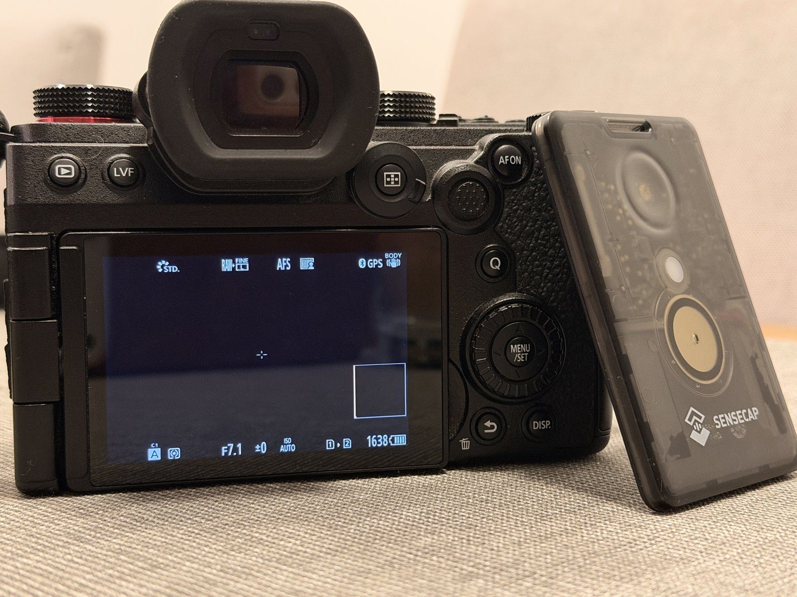

# gpxcam-t1000e

Firmware for the Seeed SenseCAP **T1000-E** tracker card that gives a Panasonic **LUMIX S5II**
the position from the card's own GPS over Bluetooth LE – no phone needed. The camera writes the
position into the EXIF data of every photo. It does the job of gpxcam, the author's Android app
that sends the phone's position to the camera; the gpxcam app and its repository are private.



*SenseCAP T1000-E next to a LUMIX S5II. The card is the camera's only GPS source, no phone involved.*

Status: pairing, everyday use with the camera and power saving all work and are tested with a
LUMIX S5II. The latest version is on the
[Releases](https://github.com/TomaszBojanowski/gpxcam-t1000e/releases) page.

## What you need

- **Seeed SenseCAP Card Tracker T1000-E for Meshtastic** – the card as sold for Meshtastic, with
  its factory UF2 bootloader (Board-ID `nRF52840-T1000-E-v1`) and SoftDevice S140 7.3.0. Inside:
  nRF52840, Airoha AG3335 GPS, Semtech LR1110 radio (kept asleep), buzzer, button, green LED,
  700 mAh battery. gpxcam replaces Meshtastic on the card; you can go back at any time
  (see [Back to Meshtastic](#back-to-meshtastic)).
- **Panasonic LUMIX S5II** (DC-S5M2) – the only camera tested so far. Other LUMIX models may work
  if they use the same Bluetooth protocol, but nobody has tried them yet. If you test one, please
  open an issue.

## Known limitations

- The camera gets a new time zone only when the card connects to it: after changing the time zone,
  switch the camera off and on (see [Set the time zone](#set-the-time-zone)).
- The battery percent is estimated from the voltage. With the USB cable plugged in the voltage
  reads higher, so the percent shown on the card page is only about right.
- Where summer time is not one hour ahead (Australia/Lord_Howe, Antarctica/Troll), the camera shows
  the right local time, but no summer-time mark.
- The time zone rules are built into the firmware (tz database 2026e since 1.2.0). When a country
  changes its rules later, the card needs a newer firmware for them.

## Install the release (Windows, macOS, Linux)

No tools needed: the card takes the firmware as a file copied to a USB drive.

1. Before you start: gpxcam replaces Meshtastic. If you may want to go back later, note your
   Meshtastic settings (channels and keys) first.
2. Download `gpxcam-t1000e-<version>.uf2` from the
   [Releases](https://github.com/TomaszBojanowski/gpxcam-t1000e/releases) page.
3. Put the card into flashing mode: hold its button and plug the USB cable in twice quickly. The
   LED lights green and a USB drive named **T1000-E** appears.
4. Open `INFO_UF2.TXT` on that drive. It must show `Board-ID: nRF52840-T1000-E-v1` and
   `SoftDevice: S140 7.3.0`. If it shows something else, stop: this firmware is not for that card.
5. Copy the `.uf2` file onto the drive. The card restarts with gpxcam and the drive disappears.
   There is no need to eject the drive. Your computer may warn that the drive was not ejected
   properly, or even report a copy error at the end – this is normal, the card restarts as soon as
   it has the whole file.
6. Pair the card with the camera, see [Pairing](#pairing-once).

The file holds only the application: the bootloader and the SoftDevice stay as they are.

## The card page

[The card page](https://tomaszbojanowski.github.io/gpxcam-t1000e/) talks to the card over USB from
Chrome or Edge on Windows, macOS or Linux (Firefox, Safari and phones cannot talk to the card):
- it shows the card's state: firmware, battery, GPS, the camera link and the time zone, refreshed
  every few seconds;
- it pairs the card with the camera, step by step, and says why if pairing fails; it can also
  forget the paired camera;
- it sets whether the card sets the camera's clock, and the time zone;
- it sets how loud the card is (see [Sounds and LED](#sounds-and-led)).

1. Plug the card into the computer with a USB cable. Close serial monitors that use it.
2. Open [the card page](https://tomaszbojanowski.github.io/gpxcam-t1000e/).
3. Click **Connect** and choose **T1000-E gpxcam**.

The page runs only in the browser and sends nothing over the internet. It sends the card only `v`,
`status`, `pair`, `pair off`, `unpair`, `clock on`, `clock off`, `sound loud`, `sound quiet`,
`sound off`, `tz` and `tz` with a zone from its list. With gpxcam 1.2 it only sets the time zone;
the rest needs 1.3.0 or newer.

On Linux, if the page says "Reading from the card failed" after a serial monitor (for example
`pio device monitor`) used the card: unplug the card and plug it in again. Such programs leave the
port with a setting that Chrome does not handle, and plugging in again resets it.

## Set the time zone

The card sets the camera's clock every time it connects: the time from the GPS and the time zone.
Without a setting the time zone is Europe/Warsaw (Central European Time), as up to version 1.1.
The time zone changes only the camera's local time; the position and the GPS time in EXIF do not
depend on it. The card keeps the setting through restarts and firmware updates and switches summer
time by itself, with the rules of the tz database (IANA).

A new time zone reaches the camera at the next connection: **switch the camera off and on** after
changing it.

### With the card page

1. Connect the card on [the card page](#the-card-page).
2. Under **The camera's clock**, find the time zone by country, city or zone name (the computer's
   own is selected already) and click **Save**.
3. Switch the camera off and on.

### With a serial terminal

Any terminal at **115200 baud** (never 1200: that rate restarts the card into its bootloader):
- Windows: the Serial Monitor of the Arduino IDE (any line ending except "No line ending"), or
  PuTTY (connection type Serial, the COM port of the card from the Device Manager, speed 115200);
- macOS: `screen /dev/cu.usbmodem* 115200` (leave it with Ctrl+A, then K and Y);
- Linux: `pio device monitor` in this repository, or `screen /dev/ttyACM0 115200`.

The card does not show what you type: type the command and press Enter.

| Command | What it does |
|---|---|
| `tz` | shows the time zone, its rule and, with a GPS fix, what the camera gets now |
| `tz Europe/Warsaw` | sets a time zone by its name in the tz database (any case; old names such as `Poland` work too) |
| `tz <+0545>-5:45` | sets a POSIX TZ rule directly (summer-time dates in the `Mm.w.d` form, offsets within ±15 h) |

### Leave the camera's clock alone (1.3.0)

If you prefer to set the camera's clock yourself, switch off **The card sets the camera's clock and
time zone** on the card page (or send `clock off`). From the next connection the card leaves the
camera's time and time zone as they are and only sends the position; the GPS time in EXIF still
comes from the card. Pairing still sets the clock once, so set the camera's time zone in its menu
after pairing. `clock on` brings the card's clock setting back; the camera takes it at the next
connection (switch the camera off and on).

Without writing the time the card cannot see at once that the camera has forgotten it (removed
from the camera's list of devices): the camera refuses the time only from a card it does not know.
So with the clock off the card stops working with the camera when the camera refuses any step of
the introduction, or ends three connections in a row before it takes a position. The card page
then says that the camera refused the card: pair them again.

## Build from source (Linux)

Linux with:
- PlatformIO: `uv tool install platformio`
- your user in the `dialout` group (access to `/dev/ttyACM0`)
- a desktop that mounts USB drives automatically under `/run/media/$USER` (GNOME, KDE)

Build:

```
pio run
```

The result is `.pio/build/t1000e/firmware.uf2`. After every build `tools/uf2check.py` checks it:
UF2 family 0xADA52840, first block at 0x27000, all blocks inside 0x27000–0xEA000. A file that
fails the check is deleted.

The time zone table (`src/tz_table_data.inc`), its test vectors and the zone list of the time zone
page are generated from the tz database of IANA in a pinned version (archives checked by their
SHA-256). After a new tz database release, update the version in the script (its first lines say
how) and run it; it needs Python 3.9+, `cc`, `make` and the network on the first run:

```
python3 tools/gen_tz_table.py            # --check: only tells whether the files are up to date
```

Flash (UF2 only):

```
tools/flash.sh          # or: pio run -t upload
```

The script checks the file, says what it will do and asks before doing it. Then it switches the
card into the UF2 bootloader (the `dfu` command), checks the Board-ID and the SoftDevice version
on the T1000-E drive and copies the file. If the card does not run gpxcam yet: hold the button
and plug the cable in twice quickly – the LED lights up and the T1000-E drive appears.

### Flashing safety

- Only UF2 files through the factory bootloader. The bootloader and SoftDevice S140 7.3.0 are
  never touched: no SWD, no mass erase, no nrfjprog.
- `uf2check.py` rejects anything outside the application area, so a wrong file cannot overwrite
  the SoftDevice or the bootloader.
- The data area (0xEA000–0xF4000, with the pairing file) is not written by flashing: the card
  keeps its pairing.
- Do not open the serial port at 1200 baud: that starts the bootloader without its drive.
- Back to Meshtastic: see the next section.

## Back to Meshtastic

1. Put the card into flashing mode: hold its button and plug the USB cable in twice quickly.
2. Install Meshtastic with the [Meshtastic Web Flasher](https://flasher.meshtastic.org) (device:
   Seeed SenseCAP T1000-E), or copy a Meshtastic `.uf2` file for the T1000-E onto the T1000-E drive.

gpxcam never changes the bootloader or the SoftDevice, so Meshtastic installs as on a new card.
Whether Meshtastic keeps its old settings has not been checked – be ready to set it up again.

## User guide

### Switching on and off

- **On:** hold the button for about 1 s (start melody), or plug in the USB cable. A shorter press
  sends the card back to sleep (the LED may blink once – that is the bootloader).
- **Off:** hold the button for 3 s (power-off melody). With the USB cable plugged in the card
  stays on: two clicks.
- Below 3.40 V the card switches itself off to protect the battery (two clicks). With the cable
  it always starts and charges.

### Pairing (once)

1. Put the card where the GPS can get a fix (outdoors or near a window): the camera needs the
   time from the GPS.
2. On the camera start pairing in its Bluetooth menu (the screen that waits for a new device).
   If the camera lists "T1000-E" from an earlier pairing, delete it there first: the camera does not
   pair a card it already knows.
3. On the card: a short click, and within 0.5 s press again and hold for 3 s – two short high
   beeps. Or click **Pair** on [the card page](#the-card-page): it shows each stage and, if
   pairing fails, why.
4. The card waits up to 120 s for GPS time and looks for the camera for up to 60 s. On success
   the camera shows "Pairing completed" and lists "T1000-E"; the card plays a rising melody.
   If it gives up: two clicks.

A short press cancels pairing. The card only connects to a camera that is in pairing mode, and
it pairs with one camera at a time: a new pairing replaces the old one.

### Normal use

Switch the card on and keep it near the camera. The card connects to the camera only when its GPS
has a position fix: the camera needs the exact time from it. After you switch the card on, the
first fix takes about 1–3 minutes outdoors or near a window; deep indoors it may not come at all.

When the camera is on, the card connects by itself (two rising beeps), sets the camera's clock
(see [Set the time zone](#set-the-time-zone); this can be switched off) and the camera shows its
Bluetooth and GPS icons.
The card sends the position at once and then every 25 s – earlier when it moves more than 20 m. If the GPS loses its fix later, the connection stays, but no position is
sent until the fix is back.

When the camera is switched off, the card notices it (two falling beeps) and waits:
- for the first 20 minutes it keeps the GPS ready and looks for the camera every second, so the
  camera gets a position about 10 s after it is switched on again (most of that time the camera
  itself is starting up);
- after that, and when the camera is out of sight for 5 minutes, the card saves power: it looks
  for the camera less often and the GPS sleeps. The camera then gets a position about 25–35 s
  after it is switched on or comes back; after many hours the GPS needs longer, up to about
  1–2 minutes.

The card never wakes a camera that is switched off.

### Sounds and LED

| Sound | Meaning |
|---|---|
| three rising notes | switched on |
| three falling notes | switching off |
| a short tick | short button press |
| two clicks | refused or given up (power off with the cable, pairing, camera, low battery) |
| two short high beeps | pairing started |
| rising melody | paired |
| two short rising beeps | connected to the camera |
| two short falling beeps | connection ended |

**Volume (1.3.0):** **Loud** (as up to 1.2), **Quiet**, or **Off** – choose under **Sound** on
[the card page](#the-card-page), or send `sound loud`, `sound quiet` or `sound off`. Off keeps only
the answers to a held button, quietly: switching on and off, pairing started, and two clicks when
the card refuses to switch off or to pair. Without them you could not tell when to let go. The card
keeps the setting through restarts and firmware updates.

| LED (green) | Meaning |
|---|---|
| a short flash every second | on, not working with a camera (no camera paired, or `link off`) |
| two short flashes every 2 s | looking for the camera |
| a short flash every 4 s | connected to the camera |
| fast blinking | `off` countdown |

## Serial console (service)

```
pio device monitor
```

| Command | What it does |
|---|---|
| `v` | version (with the git commit) and the reason of the last reset |
| `p` | state: radio, GPS, Bluetooth, pairing (card id, camera), time zone, sound, link, battery |
| `status` | the same in short `key=value` lines without the card id and the camera, for the card page |
| `log` | the last 32 events, also from times without USB |
| `off` | power off after a 15 s countdown (refused with USB; a short press cancels) |
| `dfu` | restart into the UF2 bootloader for flashing |
| `pair` / `pair off` | start / cancel pairing (as click + hold) |
| `unpair` | forget the paired camera (the card id stays: to pair with that camera again, delete "T1000-E" in its Bluetooth menu too) |
| `tz` / `tz NAME` / `tz RULE` | show / set the time zone, see [Set the time zone](#set-the-time-zone) |
| `clock` / `clock on` / `clock off` | show / set whether the card sets the camera's clock, see [Leave the camera's clock alone](#leave-the-cameras-clock-alone-130) |
| `sound` / `sound loud` / `sound quiet` / `sound off` | show / set how loud the card is, see [Sounds and LED](#sounds-and-led); a new Loud or Quiet plays two short beeps |
| `link on` / `link off` | work with the paired camera; on by itself after start when a camera is paired |
| `bat log on` / `bat log off` | battery log in flash: an entry every 10 min on the battery, up to 1024 |
| `bat log` / `bat log clear` | show / delete the battery log |
| `diag bat` | battery voltage at different settling times of the divider (about 4 s) |
| `diag snd N` | all sounds at N % PWM duty (1–50), whatever the setting, to choose the volume by ear |

**Privacy:** the log shows the camera's serial number and Bluetooth address and the card's id –
do not publish it. GPS positions are never logged.

Measuring the current with the battery log: `docs/HARDWARE.md`, section "Measuring the current".

## Tests on the PC

```
pio test -e native
node --test test/web/card_page.test.mjs
```

The modules without hardware dependencies – NMEA parser, LUMIX protocol (advertisement, byte
formats, location), camera list, UTC calendar, time zone table, POSIX time zone rules (against the
full tz database at every change of 2026–2031), time zone file, pairing record, settings file, the
camera handles kept between connections, link, battery and sound rules, the lines of `status` – are
tested with made-up data and the vectors from `docs/PROTOCOL.md`. The second command (Node.js,
tested with version 22) tests the card page with a simulated card.

## Documentation

- [docs/HARDWARE.md](docs/HARDWARE.md) – the card: bootloader, SoftDevice, flash map, DFU, pins,
  measurements and findings of every milestone, differences from Meshtastic.
- [docs/PROTOCOL.md](docs/PROTOCOL.md) – the Bluetooth LE protocol of LUMIX cameras, the
  connection parameters the S5II works with, how the camera takes the time zone, and test vectors.
- [The card page](https://tomaszbojanowski.github.io/gpxcam-t1000e/) – the card's state, pairing,
  the clock setting and the time zone from Chrome or Edge (source: `docs/index.html`).

## Sources

- Pins, board file and linker script: [Meshtastic](https://github.com/meshtastic/firmware)
  (GPL-3.0), completed from Seeed's T1000-E SDK – details in `docs/HARDWARE.md` and in the code.
- Arduino core: Meshtastic's fork of the Adafruit nRF52 core, pinned in `platformio.ini`.
- Protocol: worked out with gpxcam, the author's Android app (private, not published).

## License

GNU GPL v3.0 – see [LICENSE](LICENSE).
