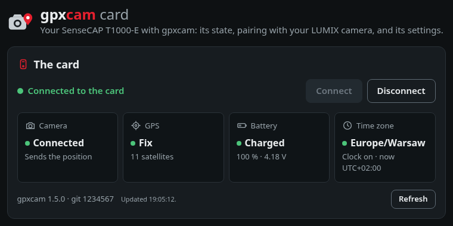
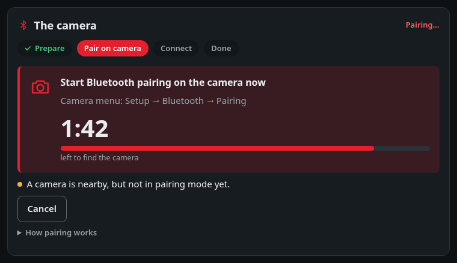
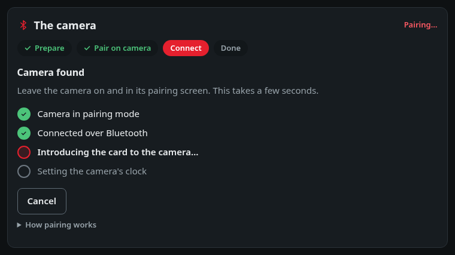
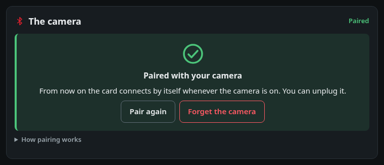
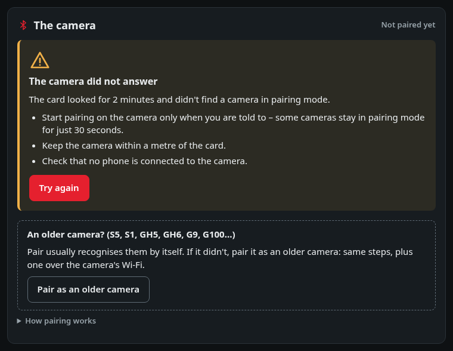
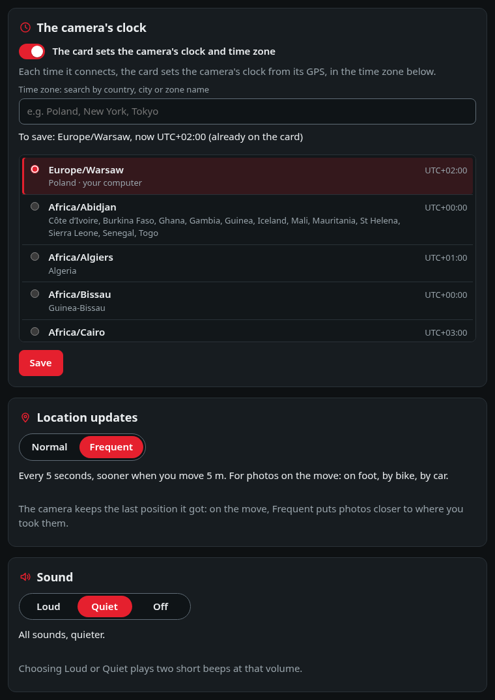
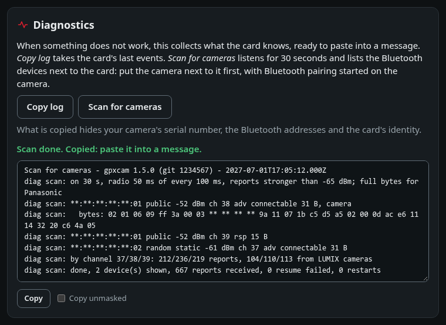

# gpxcam card – the desktop app

The [card page](https://tomaszbojanowski.github.io/gpxcam-t1000e/) in its own window, for computers without Chrome or Edge
(Firefox, Safari, Linux without Chromium). It shows the card's state and sets it up the same way:
pairing, the camera's clock and time zone, location updates and sound.

- It talks to the card over USB at 115200 baud, and only to a T1000-E running gpxcam
  (USB 2886:8057).
- It sends the card only the commands of [test/commands.json](../test/commands.json). The page
  checks them, and the app's Rust side checks them again.
- It sends nothing over the internet, and it has no Tauri plugins. Pairing an *older* camera is the
  one time it uses a network at all: only the camera's own Wi-Fi (see below).

## What it looks like



*After Connect: the card's state, refreshed every few seconds.*


*Pairing, step by step: Prepare checks the GPS by itself and reminds of the camera's list and the
phone.*



*Start pairing on the camera only now: the card is looking, for the 2 minutes counted down.*



*The camera found: the stages of the connection, a few seconds.*


*An older camera: one more step over its Wi-Fi, which the app goes on with by itself (see
[below](#pairing-an-older-camera)).*



*Paired.*



*No camera found: why, what to check, and the only place that offers pairing as with an older camera.*



*The camera's clock and time zone, the location updates and the sound.*



*Diagnostics: Scan for cameras, ready to paste into a message, with the identifiers hidden.*

The pictures come from `tools/screenshots.mjs` (`npm install`, then `npm run screenshots`): the card page in
Chromium with the app's side and a card simulated with made-up values.

## Install

Take the file for your computer from the newest "gpxcam card" release (tag `app-vX.Y.Z`) on the
[Releases](https://github.com/TomaszBojanowski/gpxcam-t1000e/releases) page. `SHA256SUMS` next to it
lets you check the download (`sha256sum -c SHA256SUMS --ignore-missing` on Linux).

**Linux** – Fedora: `sudo dnf install ./gpxcam-card-*.x86_64.rpm`; Debian, Ubuntu:
`sudo apt install ./gpxcam-card_*_amd64.deb`. The card's port belongs to the `dialout` group.
Add yourself to it once, then log out and in again:

```
sudo usermod -aG dialout $USER
```

**macOS** (Intel or Apple processor) – open the `.dmg` and drag "gpxcam card"
to Applications. The app is not signed by an Apple developer, so macOS stops it the first time:
open it once, then in System Settings → Privacy & Security click "Open Anyway" next to "gpxcam card"
and confirm. If macOS says the app is damaged, remove the download mark in Terminal and open it
again:

```
xattr -dr com.apple.quarantine "/Applications/gpxcam card.app"
```

**Windows** 10 or 11 (64-bit) – run the `.msi` (or the `-setup.exe`). The installer
is not signed, so Windows SmartScreen may say "Windows protected your PC": click "More info", then
"Run anyway". The app uses Microsoft Edge WebView2, which Windows 10 and 11 usually have; if it is
missing, the installer downloads it.

Only the Linux version is tried with a card for each release; the Windows and macOS versions are
built the same way. If something does not work there, please open an issue on GitHub.

## Pairing an older camera

> [!WARNING]
> Older cameras (LUMIX Sync generation) are experimental: [the table in the README](../README.md#cameras) shows which cameras are tested and how each one pairs.

Most newer LUMIX cameras (S5II and the like) pair straight from the card page or this app with
*Pair*. **Older** cameras – the LUMIX Sync generation – need one extra step over the camera's own
Wi-Fi, which only the app can do (a web page cannot reach the camera that way). In the app, *Pair*
recognises such a camera and goes on with that step by itself. If *Pair* does not work, the screen
that says so offers *Pair as an older camera*, which does the same from the start, for an older
camera that *Pair* does not recognise.

Before pairing, remove the phone from the camera's Bluetooth device list (Setup → Bluetooth →
Delete), or at least turn the phone's Bluetooth off. A phone that is still registered may grab the
camera the moment it starts advertising, and the card will not get in.

1. Put the card where its GPS gets a fix, outdoors or by a window. On a card that is not paired yet
   the app switches the GPS on as soon as it connects (gpxcam 1.5.0 or newer), otherwise *Pair*
   does. *GPS has a fix* on the first screen ticks itself when it is ready, which can take a few
   minutes after a fresh start.
2. Click *Pair* (or, on the screen of a pairing that did not work, *Pair as an older camera*). Do
   not start pairing on the camera yet.
3. **Only when the app says *Start Bluetooth pairing on the camera now*** do it (the camera's
   Bluetooth menu → Pairing). The order matters: the camera stays in pairing mode only about 30
   seconds, so the card must already be looking for it (for up to 2 minutes, counted down). The card
   introduces itself over Bluetooth; the camera then shows its Wi-Fi network name (and a password,
   if one is set) on its screen.
4. Join that Wi-Fi network on this computer, by hand. On the S5 and similar it has **no password by
   default**, so just pick it from the list; if the camera asks for one, it is on the camera's screen
   or in its Wi-Fi setup: **[Setup] → [Wi-Fi] → [Wi-Fi Setup] → [Wi-Fi Password]** (see the
   [S5 manual](https://eww.pavc.panasonic.co.jp/dscoi/DC-S5/GA_GW_GC_GH_GN_GT_GD/DC-S5_DVQP2213ZD_full_eng.pdf),
   pages 424–426). The app sends one discovery packet on the camera's network only, registers the
   card over the camera's own address (192.168.54.1) – nothing goes to the internet – and tells you
   how it went.

If the card does not find the camera, click *Try again*: the card keeps its GPS on for 10 minutes
after a pairing that did not succeed, so it starts looking for the camera at once.

If the Wi-Fi step fails on the camera's network (for example the camera did not confirm), the card
keeps waiting for it, up to 5 minutes from its introduction: click *Try the Wi-Fi step again*.
If the app was closed or the cable came off in the middle, connect again: the app opens on the step
the card is at, with *Cancel*; at the Wi-Fi step it goes on with it by itself.

After it succeeds, the card connects to the camera over Bluetooth alone, like any other pairing.
The protocol is in [docs/PROTOCOL.md](../docs/PROTOCOL.md).

## How it is made

- `../docs/index.html` is the page. `tools/app_frontend.py` copies it, with the script it loads
  (`../docs/zones.js`), to `dist/` and makes two changes: its content security policy lets the page
  talk to the app over Tauri's IPC, and "About this app" shows the version from
  `src-tauri/Cargo.toml`.
- `src-tauri/` is the Rust side. It finds the card, opens its port at 115200 baud with DTR, passes
  the card's lines to the page and sends the allowed commands.
- The page finds the app through `window.__TAURI__`, and the page's Card class works over it as
  over Web Serial.

## Build and run on Linux (Fedora)

```
sudo dnf install webkit2gtk4.1-devel librsvg2-devel libxdo-devel openssl-devel systemd-devel gcc
cargo install tauri-cli --version "^2" --locked
cd app/src-tauri
cargo tauri dev
```

`cargo tauri dev` builds the app and opens its window. The first build takes a few minutes.
`cargo tauri build` makes the installers in `src-tauri/target/release/bundle/`.

On Linux add yourself to the `dialout` group, as under Install.

## Versions

The app has its own version numbers, from 1.0.0, apart from the firmware's. Each release of the app
says which gpxcam it was tested with. It works with older gpxcam as far as the firmware allows:

| gpxcam on the card | What the app can do |
|---|---|
| 1.5.0 or newer (and the betas from 1.5.0-beta.2) | everything |
| 1.5.0-beta.1 | everything but *Pair* recognising an older camera, and the GPS switched on when the app connects |
| 1.4.0 | everything but older cameras and *Scan for cameras* |
| 1.3.x | as 1.4.0, and not choosing how often the position is sent |
| 1.2.x | only the time zone |
| before 1.2.0 | nothing: install the newest gpxcam first |
